<!--
  Profile README · Harsh Gorjiwala
  All visuals in /assets are hand-written SVG + CSS keyframes (no JS, no external fonts),
  so they animate inside GitHub's sandboxed  renderer.
  Replace harshgorjiwala below (2 places) and push to the repo named after your username.
-->

  

<h2 align="center">What I'm building</h2>

  A portfolio of vertical SaaS products on one shared backbone — auth, e-signing, storage and payments built once and reused across every product.

  

 

<h2 align="center">Stack</h2>

  

 

<h2 align="center">How I work</h2>

<table align="center">
  <tr>
    <td align="center" width="33%">
      <h3>🧭 Product-first</h3>
      
I own the product and the architecture and direct the build — spec → build → ship → measure.

    </td>
    <td align="center" width="33%">
      <h3>🧱 Divide &amp; conquer</h3>
      
Cross-cutting infrastructure is a shared service, not copy-paste. Each product only carries what makes it different.

    </td>
    <td align="center" width="33%">
      <h3>🤖 AI-native workflow</h3>
      
Claude Code is the primary implementer; every major session ends with a <code>HANDOFF.md</code> so the next one starts warm.

    </td>
  </tr>
</table>

 

<h2 align="center">GitHub</h2>

  <picture>
    <source media="(prefers-color-scheme: dark)" srcset="https://github-readme-stats.vercel.app/api?username=harshgorjiwala&show_icons=true&hide_border=true&bg_color=0e1422&title_color=9ec5ff&icon_color=22d3ee&text_color=aab6c9&ring_color=818cf8" />
    
  </picture>
  <picture>
    <source media="(prefers-color-scheme: dark)" srcset="https://github-readme-streak-stats.herokuapp.com/?user=harshgorjiwala&hide_border=true&background=0e1422&ring=818cf8&fire=22d3ee&currStreakLabel=9ec5ff&sideLabels=aab6c9&dates=5b6b85&currStreakNum=f1f4fb&sideNums=f1f4fb" />
    
  </picture>

 

<h2 align="center">Reach me</h2>

  
  &nbsp;
  
  <!-- Add when ready:
  
  -->

 

  Every graphic on this page is a single hand-written SVG — CSS keyframes only, no JavaScript, no external fonts. Open <code>/assets</code> to see how.

